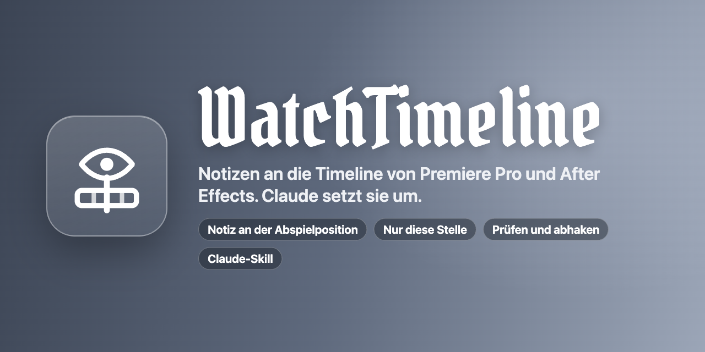
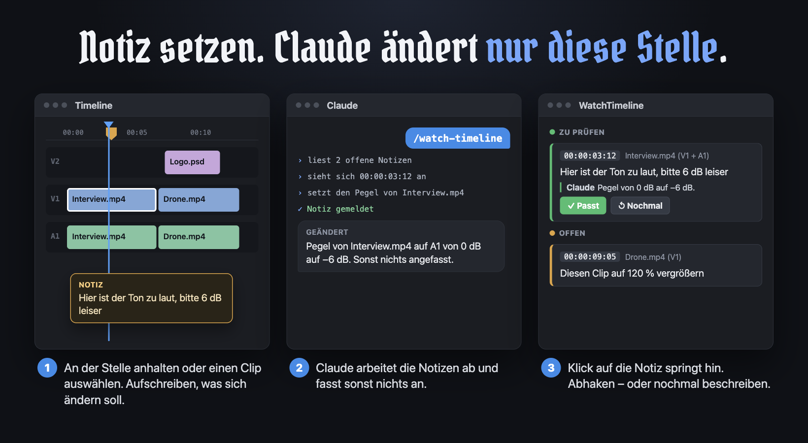
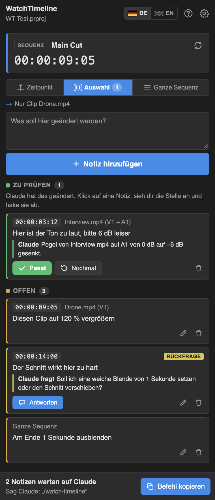
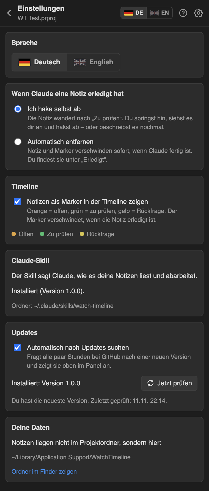
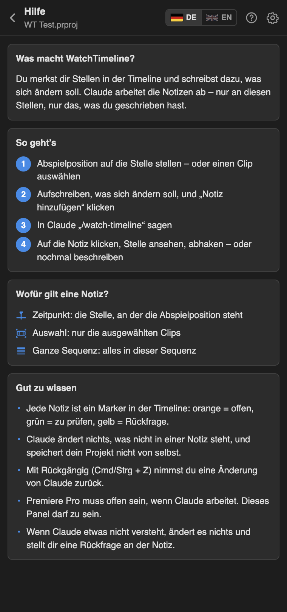

<p align="center">
  
</p>

<p align="center">
  Notizen an die Timeline von Premiere Pro und After Effects.<br>
  Claude arbeitet sie ab – nur an diesen Stellen, nur das, was du geschrieben hast.
</p>

<p align="center">
  <a href="README.md">English</a> · <b>Deutsch</b>
</p>

<p align="center">
  <a href="https://github.com/Richard2007-21/WatchTimeline/releases/latest/download/WatchTimeline.zip"><b>Download</b></a>
  &nbsp;·&nbsp;
  <a href="https://github.com/Richard2007-21/WatchTimeline/releases">Alle Versionen</a>
  &nbsp;·&nbsp;
  <a href="CHANGELOG.md">Änderungen</a>
</p>

<p align="center">
  
  
  
  
  
  
</p>

<p align="center">
  
</p>

## So funktioniert es

1. **Notiz setzen.** Halte die Abspielposition an einer Stelle an oder wähle einen Clip oder eine Ebene aus. Schreib auf, was sich ändern soll, und klicke **Notiz hinzufügen**. In der Timeline erscheint ein Marker.
2. **Claude Bescheid sagen.** Sag in Claude Code `/watch-timeline`. Claude liest die offenen Notizen, sieht sich jede Stelle an und ändert nur, was in der Notiz steht.
3. **Prüfen.** Ein Klick auf die Notiz springt zur Stelle. **Passt** hakt sie ab und entfernt den Marker. **Nochmal** gibt sie mit neuen Worten an Claude zurück.

<p align="center">
  
</p>

WatchTimeline besteht aus zwei Teilen in einem Download:

- eine **Erweiterung** (Panel) für Premiere Pro und After Effects. Dort schreibst du die Notizen und prüfst die Ergebnisse
- ein **Claude-Skill** (`watch-timeline`). Er sagt Claude, wie es die Notizen liest und wie es in beiden Programmen etwas ändert

## Bildschirmfotos

| Notizen | Einstellungen | Hilfe |
|---|---|---|
|  |  |  |

## Installation

Du brauchst Premiere Pro oder After Effects (2020 oder neuer), [Claude Code](https://claude.com/claude-code) und [Node.js](https://nodejs.org) 14 oder neuer.

### macOS

1. Lade [**WatchTimeline.zip**](https://github.com/Richard2007-21/WatchTimeline/releases/latest/download/WatchTimeline.zip) herunter und entpacke es.
2. Doppelklick auf **Install WatchTimeline.command**.
   macOS meldet vielleicht einen nicht verifizierten Entwickler: Rechtsklick auf die Datei, **Öffnen** wählen, dann noch einmal **Öffnen**.
3. Starte Premiere Pro oder After Effects neu und öffne **Fenster › Erweiterungen › WatchTimeline**.
4. Starte Claude Code neu.

Lieber im Terminal? Im entpackten Ordner:

```bash
bash scripts/install-mac.sh
```

### Windows

1. Lade [**WatchTimeline.zip**](https://github.com/Richard2007-21/WatchTimeline/releases/latest/download/WatchTimeline.zip) herunter und entpacke es.
2. Doppelklick auf **scripts\install-windows.cmd**.
3. Starte Premiere Pro oder After Effects neu und öffne **Fenster › Erweiterungen › WatchTimeline**.
4. Starte Claude Code neu.

> [!NOTE]
> **Was macht der Installer?** WatchTimeline ist eine kostenlose Erweiterung und nicht über Adobes kostenpflichtiges Programm signiert. Adobe-Programme laden unsignierte Erweiterungen nur, wenn die Einstellung `PlayerDebugMode` an ist. Das Skript schaltet sie an und kopiert zwei Ordner:
> die Erweiterung nach `~/Library/Application Support/Adobe/CEP/extensions/WatchTimeline` (Windows: `%APPDATA%\Adobe\CEP\extensions\WatchTimeline`),
> den Claude-Skill nach `~/.claude/skills/watch-timeline` (Windows: `%USERPROFILE%\.claude\skills\watch-timeline`).

Das Panel zeigt unten an, ob der Skill installiert ist, und installiert ihn auf Wunsch mit einem Klick.

### Deinstallieren

- macOS: `bash scripts/uninstall-mac.sh`
- Windows: die zwei oben genannten Ordner löschen

Deine Notizen bleiben, wo sie sind.

### Updates

WatchTimeline sucht hier auf GitHub nach einer neuen Version (höchstens alle 6 Stunden). Gibt es eine, erscheint oben im Panel ein Banner:

- **Jetzt aktualisieren** lädt `WatchTimeline.zip` der Version, tauscht die Dateien der Erweiterung aus und erneuert den Claude-Skill. Danach Premiere Pro / After Effects neu starten.
- **Neuerungen** zeigt, was neu ist.
- Kopien aus einem Git-Ordner (`install-mac.sh --link`) oder in einem schreibgeschützten Ordner bekommen stattdessen **Herunterladen**.

Die Prüfung schaltest du in **Einstellungen › Updates** ab oder startest sie von Hand.

## WatchTimeline benutzen

**Das Panel**

| | |
|---|---|
| Karte oben | Die Sequenz oder Komposition, die vorne ist, und die Zeit der Abspielposition |
| **Zeitpunkt** | Die Notiz gilt für die Stelle, an der die Abspielposition steht |
| **Auswahl** | Die Notiz gilt nur für die ausgewählten Clips oder Ebenen. Wird von selbst gewählt, wenn etwas ausgewählt ist |
| **Ganze Sequenz / Komposition** | Die Notiz gilt für alles darin. In After Effects gilt sie für ein Bild, wenn es im Projektfenster ausgewählt ist |
| **Notiz hinzufügen** | Speichert die Stelle und deinen Text (Cmd/Strg + Eingabe) |
| Eine Notiz | Klick springt zur Stelle; ihre Clips oder Ebenen werden ausgewählt |
| **Passt** | Die Änderung stimmt: Die Notiz ist erledigt, ihr Marker verschwindet |
| **Nochmal** | Passt noch nicht: Schreib, was fehlt. Die Notiz ist wieder offen |
| **Antworten** | Claude hat nachgefragt, statt zu raten: antworten, die Notiz ist wieder offen |
| **Befehl kopieren** | Kopiert `/watch-timeline` für Claude |

**Marker in der Timeline**

Jede Notiz ist ein Marker: orange = offen, grün = zu prüfen, gelb = Claude hat eine Rückfrage. In Premiere Pro sitzt er in der Sequenz, in After Effects auf der Komposition oder auf den Ebenen der Notiz. In den Einstellungen schaltest du Marker ab.

**Mit Claude**

Sag `/watch-timeline` oder einfach „arbeite meine Timeline-Notizen ab“. Claude

- liest nur die offenen Notizen,
- sieht sich die Stelle an (Clips oder Ebenen, Effekte, Werte) und kann das Bild dort berechnen und ansehen,
- ändert nur, was in der Notiz steht, und nur dort,
- schreibt an die Notiz, was es geändert hat, mit den Werten,
- fragt an der Notiz nach, wenn etwas unklar ist, statt zu raten.

Dein Projekt speichert es nie. Rückgängig (Cmd/Strg + Z) nimmt eine Änderung zurück; in After Effects ist es ein Schritt pro Notiz.

**Manuell oder automatisch**

Unter **Einstellungen › Wenn Claude eine Notiz erledigt hat**:

- **Ich hake selbst ab** (Standard): Die Notiz wandert nach *Zu prüfen*. Du siehst sie dir an und hakst ab.
- **Automatisch entfernen**: Notiz und Marker verschwinden sofort, wenn Claude fertig ist.

## Funktionen

**Notizen**
- Drei Ziele: ein Zeitpunkt, ausgewählte Clips oder Ebenen, eine ganze Sequenz oder Komposition
- Jede Notiz ist ein kleiner Verlauf: dein Text, was Claude geändert hat, was du dann gesagt hast
- Mit einem Klick zur Stelle springen, auch in eine andere Sequenz oder Komposition
- Notizen für mehrere Projekte, beide Programme gleichzeitig

**Claude-Skill**
- Arbeitet in Premiere Pro und After Effects über ein kleines Befehlswerkzeug (`wt.js`), ohne zusätzlichen Server
- `inspect` zeigt, was an einer Stelle liegt, `frame` berechnet sie als Bild, `eval` führt die Änderung aus
- Merkblätter für beide Programme mit Mustern, die in den echten Programmen getestet sind
- Funktioniert auch bei geschlossenem Panel: Ein Hintergrund-Dienst der Erweiterung antwortet

**Oberfläche**
- Deutsch und Englisch, umschalten mit den Flaggen oben
- Eingebaute Hilfe und Tooltips
- Folgt der hellen oder dunklen Oberfläche des Adobe-Programms

## Wo deine Daten liegen

| Was | Wo |
|---|---|
| Notizen eines Projekts | `projects/<Name>-<Kennung>.json` im Datenordner. Neben deine Projektdatei wird nichts geschrieben |
| Einstellungen | `settings.json` im Datenordner |
| Datenordner | macOS `~/Library/Application Support/WatchTimeline`, Windows `%APPDATA%\WatchTimeline` |

Notizen gehören zum Pfad der Projektdatei. Wenn du das Projekt verschiebst oder umbenennst, bleiben die Notizen beim alten Pfad; die Marker bleiben im Projekt.

## Datenschutz

WatchTimeline sammelt keine Daten. Erweiterung und Skill tauschen sich über Dateien im Datenordner auf deinem Rechner aus; es wird kein Netzwerk-Port geöffnet. Die einzige Netzwerk-Anfrage der Erweiterung ist die Update-Prüfung: Sie fragt die öffentliche GitHub-API nach der neuesten Version dieses Repositorys (abschaltbar unter Einstellungen › Updates). Was Claude von deinem Projekt sieht (die Notiz, Namen von Clips und Ebenen, Werte und berechnete Bilder), geht an Claude wie alles andere in deinem Gespräch.

## Gut zu wissen

- Das Programm muss mit dem Projekt offen sein, während Claude arbeitet. Das Panel darf zu sein.
- Claude ändert über Skripte. Manches lässt sich nicht zuverlässig per Skript machen (in Premiere Pro zum Beispiel Geschwindigkeit ändern oder neue Titel anlegen). Dann fragt es an der Notiz nach, statt etwas anderes zu tun.
- Namen von Effekten und Überblendungen hängen von der Sprache des Programms ab; der Skill schlägt sie nach, statt englische Namen anzunehmen.
- In After Effects teilen sich Notizen eines nie gespeicherten Projekts eine Liste.
- Ein von Hand gelöschter Marker löscht die Notiz nicht. Lösche die Notiz im Panel.

## Selbst bauen

```bash
git clone https://github.com/Richard2007-21/WatchTimeline.git
cd WatchTimeline
npm test                          # Notizen, Brücke, Skill, Updater – ohne Adobe-Programm
bash scripts/install-mac.sh --link   # diesen Ordner als installierte Erweiterung und Skill benutzen
bash scripts/build-release.sh     # dist/WatchTimeline.zip
```

| Ordner | Inhalt |
|---|---|
| `client/` | Das Panel und die unsichtbare Hintergrund-Seite (HTML, CSS, JavaScript) |
| `host/` | ExtendScript für Premiere Pro und After Effects: Stelle, Marker, Springen, Ansehen, Bild |
| `lib/` | Notiz-Speicher, Aktionen, Datei-Brücke, Updater, Skill-Installer, Texte |
| `skill/watch-timeline/` | Der Claude-Skill: `SKILL.md`, `scripts/wt.js`, Merkblätter |
| `tests/` | Tests mit einem simulierten Programm |

Debug-Ports von Panel und Hintergrund-Seite: Premiere Pro 8098 / 8099, After Effects 8100 / 8101.

## Lizenz

[MIT](LICENSE). WatchTimeline gehört nicht zu Adobe oder Anthropic. Adobe, Premiere Pro und After Effects sind Marken von Adobe; Claude ist eine Marke von Anthropic. Die Titelschrift in den Bildern ist [Pirata One](https://fonts.google.com/specimen/Pirata+One) (SIL Open Font License).
