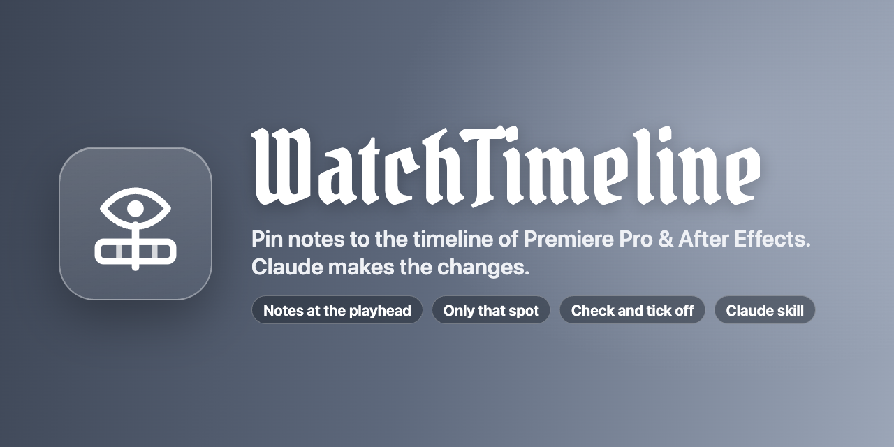
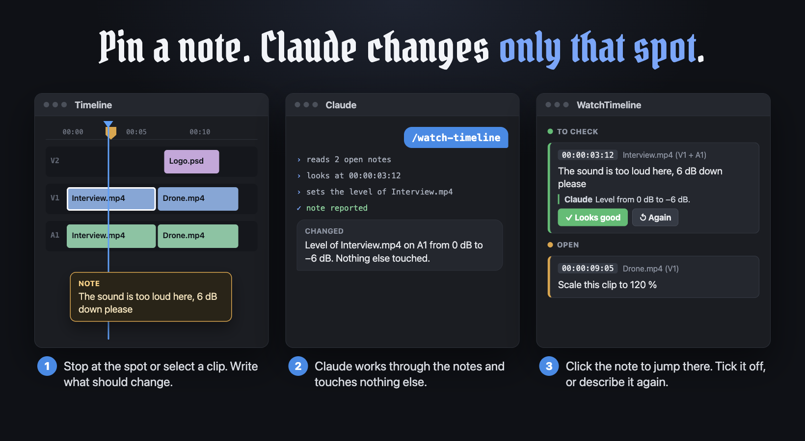
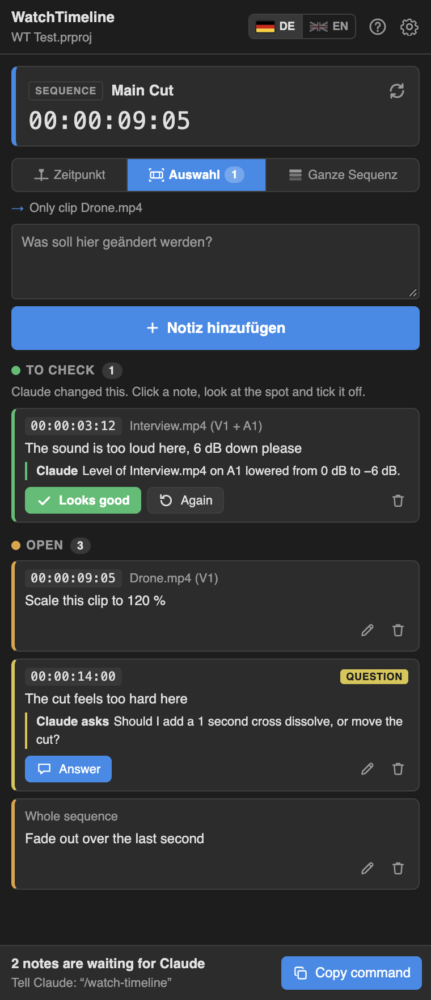
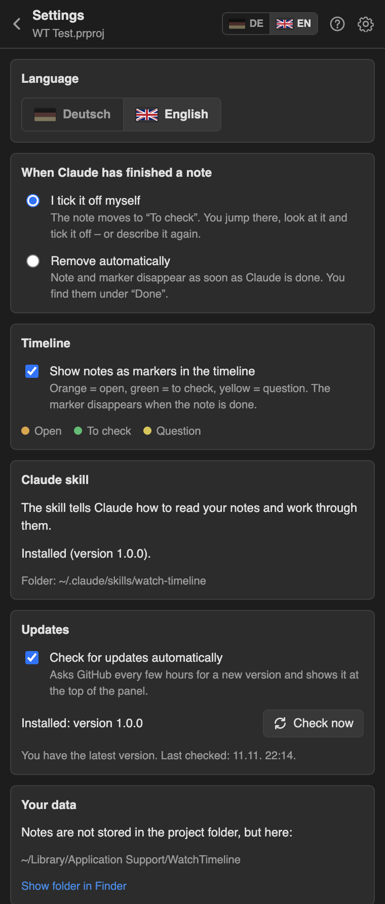
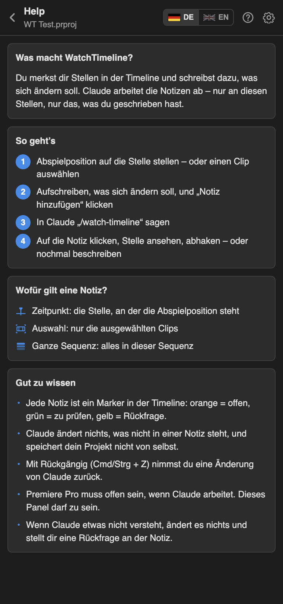

<p align="center">
  
</p>

<p align="center">
  Pin notes to the timeline of Premiere Pro and After Effects.<br>
  Claude works through them – only at those spots, only what you wrote.
</p>

<p align="center">
  <b>English</b> · <a href="README.de.md">Deutsch</a>
</p>

<p align="center">
  <a href="https://github.com/Richard2007-21/WatchTimeline/releases/latest/download/WatchTimeline.zip"><b>Download</b></a>
  &nbsp;·&nbsp;
  <a href="https://github.com/Richard2007-21/WatchTimeline/releases">All versions</a>
  &nbsp;·&nbsp;
  <a href="CHANGELOG.md">Changelog</a>
</p>

<p align="center">
  
  
  
  
  
  
</p>

<p align="center">
  
</p>

## How it works

1. **Pin a note.** Stop the playhead at a spot, or select a clip or layer. Write what should change and click **Add note**. A marker appears in the timeline.
2. **Tell Claude.** Say `/watch-timeline` in Claude Code. Claude reads the open notes, looks at each spot and changes only what the note asks for.
3. **Check it.** Click a note to jump to its spot. **Looks good** ticks it off and removes the marker. **Again** sends it back to Claude with new words.

<p align="center">
  
</p>

WatchTimeline is two parts that come in one download:

- an **extension** (panel) for Premiere Pro and After Effects, where you write the notes and check the results
- a **Claude skill** (`watch-timeline`) that tells Claude how to read the notes and how to change things in both apps

## Screenshots

| Notes | Settings | Help |
|---|---|---|
|  |  |  |

## Installation

You need Premiere Pro or After Effects (2020 or later), [Claude Code](https://claude.com/claude-code) and [Node.js](https://nodejs.org) 14 or later.

### macOS

1. Download [**WatchTimeline.zip**](https://github.com/Richard2007-21/WatchTimeline/releases/latest/download/WatchTimeline.zip) and unzip it.
2. Double-click **Install WatchTimeline.command**.
   macOS may say the file is from an unidentified developer: right-click it, choose **Open**, then **Open** again.
3. Restart Premiere Pro or After Effects and open **Window › Extensions › WatchTimeline**.
4. Restart Claude Code.

Prefer the Terminal? In the unzipped folder run:

```bash
bash scripts/install-mac.sh
```

### Windows

1. Download [**WatchTimeline.zip**](https://github.com/Richard2007-21/WatchTimeline/releases/latest/download/WatchTimeline.zip) and unzip it.
2. Double-click **scripts\install-windows.cmd**.
3. Restart Premiere Pro or After Effects and open **Window › Extensions › WatchTimeline**.
4. Restart Claude Code.

> [!NOTE]
> **What does the installer do?** WatchTimeline is a free extension and not signed through Adobe's paid program. Adobe apps only load unsigned extensions when the setting `PlayerDebugMode` is on. The script turns it on and copies two folders:
> the extension to `~/Library/Application Support/Adobe/CEP/extensions/WatchTimeline` (Windows: `%APPDATA%\Adobe\CEP\extensions\WatchTimeline`),
> the Claude skill to `~/.claude/skills/watch-timeline` (Windows: `%USERPROFILE%\.claude\skills\watch-timeline`).

The panel shows at the bottom whether the skill is installed, and can install it with one click.

### Uninstall

- macOS: `bash scripts/uninstall-mac.sh`
- Windows: delete the two folders named above

Your notes stay where they are.

### Updates

WatchTimeline looks for a new release here on GitHub (at most every 6 hours). When there is one, a banner appears at the top of the panel:

- **Update now** downloads `WatchTimeline.zip` of the release, replaces the extension files and renews the Claude skill. Restart Premiere Pro / After Effects afterwards.
- **What's new** shows the release notes.
- Copies installed from a Git folder (`install-mac.sh --link`) or into a read-only folder get a **Download** button instead.

Switch the check off or run it by hand in **Settings › Updates**.

## Using WatchTimeline

**The panel**

| | |
|---|---|
| Card at the top | The sequence or composition in front and the time of the playhead |
| **Point in time** | The note is about the spot where the playhead is |
| **Selection** | The note is only about the selected clips or layers. Chosen by itself when something is selected |
| **Whole sequence / composition** | The note is about everything in it. In After Effects, with an image selected in the Project panel, the note is about that image |
| **Add note** | Saves the spot and your text (Cmd/Ctrl + Enter) |
| A note | Click it to jump to the spot; its clips or layers are selected |
| **Looks good** | The change is right: the note is done and its marker disappears |
| **Again** | Not right yet: write what is missing, the note is open again |
| **Answer** | Claude asked something instead of guessing: answer, the note is open again |
| **Copy command** | Copies `/watch-timeline` for Claude |

**Markers in the timeline**

Every note is a marker: orange = open, green = to check, yellow = Claude has a question. In Premiere Pro it sits in the sequence, in After Effects on the composition or on the layers of the note. Switch markers off in the settings.

**With Claude**

Say `/watch-timeline`, or simply “work through my timeline notes”. Claude

- reads only the open notes,
- inspects the spot (clips or layers, effects, values) and can render that frame to look at it,
- changes only what the note says and only there,
- writes on the note what it changed, with the values,
- asks on the note when something is unclear, instead of guessing.

It never saves your project. Undo (Cmd/Ctrl + Z) takes a change back; in After Effects one undo step per note.

**Manual or automatic**

In **Settings › When Claude has finished a note**:

- **I tick it off myself** (default): the note moves to *To check*. You look at it and tick it off.
- **Remove automatically**: note and marker disappear as soon as Claude is done.

## Features

**Notes**
- Three targets: a point in time, selected clips or layers, a whole sequence or composition
- Every note is a small thread: your text, what Claude changed, what you said then
- Jump to a note's spot with one click, also into another sequence or composition
- Notes of several projects, both apps at the same time

**Claude skill**
- Works in Premiere Pro and After Effects through one small command line (`wt.js`), no extra server
- `inspect` shows what is at a spot, `frame` renders it as an image, `eval` runs the change
- Reference sheets for both apps with patterns that were tested in the real apps
- Works while the panel is closed: a background service of the extension answers

**Interface**
- English and German, switch with the flags at the top
- Built-in help and tooltips
- Follows the light or dark interface of the Adobe app

## Where your data lives

| What | Where |
|---|---|
| Notes of a project | `projects/<name>-<id>.json` in the data folder. Nothing is written next to your project file |
| Settings | `settings.json` in the data folder |
| Data folder | macOS `~/Library/Application Support/WatchTimeline`, Windows `%APPDATA%\WatchTimeline` |

Notes belong to the path of the project file. If you move or rename the project, its notes stay with the old path; the markers stay in the project.

## Privacy

WatchTimeline collects no data. The extension and the skill talk to each other through files in the data folder on your computer; no network port is opened. The only network request of the extension is the update check: it asks the public GitHub API for the latest release of this repository (switch it off in Settings › Updates). What Claude sees of your project (the note, clip and layer names, values, and frames it renders) goes to Claude like everything else in your conversation.

## Good to know

- The app has to be running with the project open while Claude works. The panel may be closed.
- Claude changes things through scripting. Some things cannot be scripted reliably (in Premiere Pro for example speed changes or new titles). Then it asks on the note instead of doing something else.
- Effect and transition names follow the language of the app; the skill looks them up instead of assuming English names.
- In After Effects, notes on a project that was never saved share one list.
- A marker you delete by hand does not delete its note. Delete the note in the panel.

## Build it yourself

```bash
git clone https://github.com/Richard2007-21/WatchTimeline.git
cd WatchTimeline
npm test                          # notes, bridge, skill, updater – no Adobe app needed
bash scripts/install-mac.sh --link   # use this folder as the installed extension and skill
bash scripts/build-release.sh     # dist/WatchTimeline.zip
```

| Folder | What is in it |
|---|---|
| `client/` | The panel and the hidden background page (HTML, CSS, JavaScript) |
| `host/` | ExtendScript for Premiere Pro and After Effects: context, markers, jump, inspect, frame |
| `lib/` | Notes store, actions, the file bridge, updater, skill installer, texts |
| `skill/watch-timeline/` | The Claude skill: `SKILL.md`, `scripts/wt.js`, reference sheets |
| `tests/` | Tests with a stand-in host |

Debug ports of the panel and the background page: Premiere Pro 8098 / 8099, After Effects 8100 / 8101.

## License

[MIT](LICENSE). WatchTimeline is not affiliated with Adobe or Anthropic. Adobe, Premiere Pro and After Effects are trademarks of Adobe; Claude is a trademark of Anthropic. The title font in the images is [Pirata One](https://fonts.google.com/specimen/Pirata+One) (SIL Open Font License).
